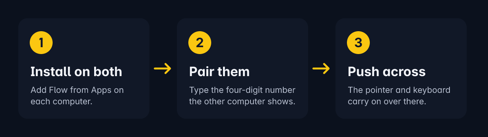

<p align="center"></p>

<p align="center">


</p>

Flow is a Trindle plugin. It lets the mouse and keyboard of one computer
work another computer on your network. It also shares the clipboard and
copied files between the two. Either computer can be the one whose mouse and
keyboard you use.

The two computers talk to each other directly, over an encrypted link. The
link trusts only the computer you paired. There is no account and no server
in between, and nothing leaves your network. If you hold Ctrl, Alt and Shift
for a second, the mouse and keyboard always come back to this computer.

The full help is in [docs/HELP.md](docs/HELP.md). It covers every setting
and what to do when something goes wrong.

Comments are stripped from the published code to keep it lean.

## How it works

<p align="center"></p>

## Quick start

Install Flow on both computers from Apps (the Plugins page), and allow what
it asks for. Then, in Flow's settings:

- On the computer whose mouse and keyboard you want to use, switch on
  **This computer controls the other one**. Under **The other computer is**,
  choose which side of its screen the other computer sits on.
- On the other computer, leave that switch off.

Next, pair them. On the computer you want to control, go to **Computer that
controls this one**. It lists the controlling computers Flow has found. Pick
yours, and a four-digit number appears.

Now go to the controlling computer. Under **Computer asking to be
controlled**, pick the other computer. Then type the number under **Number
that computer shows**.

This is where people often go wrong. You type the number on the controlling
computer, not on the one showing it. Once they are paired, the two computers
find each other on the local network by themselves. To unpair them, pick
Nobody.

## Using it

Push the pointer off the side of the screen you chose. It carries on on the
other computer, and the keyboard goes with it. To come back, push the
pointer against the side that faces home. Moving along an edge or brushing
it doesn't cross, and crossing doesn't open the ring. Ctrl+Alt+S switches
without pushing.

You can always hold Ctrl, Alt and Shift together for a second to bring the
mouse and keyboard back. They also come back when the screen locks or Flow
stops. If the other computer stops answering, the pointer comes back by
itself.

## Clipboard and files

What you copy on one computer can be pasted on the other. Copied files
arrive in a Flow folder inside Downloads. If a file stops part way, Flow
counts it as lost and removes the part that arrived. It never pastes a copy
that has a lost file in it.

## Unlocking the other computer

The controlling computer can unlock the other one's lock screen with your
PIN. It never uses the password. Flow asks for the PIN each time. It sends
the PIN over its own link to the locked computer and nowhere else. Once the
PIN has been tried, Flow wipes its own copies as far as it can.

The locked computer's Trindle checks the PIN and counts the tries. After
five wrong tries, only the password unlocks it. To start, choose "Unlock" and
the computer's name in Flow's ring menu. Trindle then shows the PIN box.

## What it does

- Shares one computer's mouse and keyboard with another, on any side of the
  screen.
- Shares the clipboard both ways.
- Carries files you copied across to Downloads/Flow.
- Unlocks the other computer's lock screen with your PIN.
- Pairs with a four-digit number that is never sent.
- Finds the paired computer on the local network by itself.
- Lets you disconnect and connect again from the ring menu, and you stay
  paired.

## Settings

You can find these on Flow's settings page. The last column shows the
command that changes the same setting.

| Setting | Default | What it does | Command |
|---|---|---|---|
| This computer controls the other one | off | On: this computer's mouse and keyboard are shared. Off: this computer is the one being controlled. | `flow set role control` |
| Computer that controls this one | none | On the controlled computer, the computer to pair with. Pick Nobody to unpair. | `flow use ID` |
| Computer asking to be controlled | none | On the controlling computer, the computer you allow to pair. | `flow allow ID` |
| Number that computer shows | none | The four-digit number the other computer shows. | `flow allow ID`, number on standard input |
| The other computer is | Right | The side of this screen the pointer leaves from. | `flow set other_side Left` |
| Cross only by shortcut or menu | off | On: pushing against the side doesn't cross. | `flow set shortcut_only on` |
| Computer on the left, right, above, below | none | If you have more than one other computer, which one sits on each side. | `flow set left_computer ID` |
| Pointer speed on the other computer | Normal | Slower, Normal, Faster or Much faster. | `flow set pointer_speed Faster` |
| Share the clipboard with the other computer | on | Copy on one, paste on the other. | `flow set share_clipboard off` |
| Receive files copied on the other computer | on | Files you copy on the other computer come across. | `flow set share_files off` |
| Keep received files in Downloads/Flow | on | Off: received files go to a temporary folder and are not kept. | `flow set files_keep off` |
| Tailscale address of the other computer | none | On the controlled computer, the address to use when the other computer isn't found on the local network. | `flow set address 100.64.0.7` |
| Look for the other computer on this network | on | Off: Flow doesn't look for the other computer or answer it, so the controlled computer needs the address above. Changing this restarts the link. | `flow set discovery off` |
| Different folder for received files | none | A full folder path. Empty: Downloads/Flow. | `flow set files_folder /home/john/Flow` |

## Commands

    flow run             share or receive the mouse and keyboard, as the settings say
    flow tell            show how Flow is getting on, in the ring
    flow settings        print the settings
    flow set KEY VALUE   change one setting
    flow forget          unpair and make a new key
    flow allow ID        let a computer that is asking to pair do so; type the number it shows
    flow use ID          ask a computer Flow found to pair with this one
    flow goto ID         take the pointer over to that computer
    flow switch          go to the other computer, or come back
    flow home            bring the pointer back to this computer
    flow drop ID         disconnect one computer until you connect
    flow connect         share again after a disconnect
    flow disconnect      stop sharing until you connect, and stay paired
    flow unlock [ID]     unlock that computer's screen with the PIN, read from standard input
    flow version         print the version
    flow help            print this list

## Where your data lives

Flow keeps everything on the two computers, inside its own home in its
Trindle box. Its settings, the computers it is paired with and each one's
key are in `~/.config/flow/config.json`. This computer's certificate and
private key are in `~/.config/flow/cert.pem` and `key.pem`. Only you can
read all three. Received files go to Downloads/Flow. If the settings file
is damaged, Flow saves it as `config.json.bad` and starts afresh.

## Permissions

Flow asks for these permissions:

- The network.
- Your folders. Received files go to Downloads/Flow.
- Notifications.
- Running from login.
- Controlling the keyboard, mouse and clipboard. The computer being
  controlled needs this, and both computers need it for the clipboard.
- Sharing the mouse and keyboard with another computer. The controlling
  computer needs this.

Each one is off until you allow it. You can do that in the window that opens
when you install Flow, or later in Settings, Permissions. A change there
takes effect at once. If an update to Trindle adds a permission, log out and
back in once and it takes effect.

## Security

The link between the two computers uses TLS 1.3 only, and each side pins the
other's certificate. Pairing uses SPAKE2 over the four-digit number, tied to
that link. So the number is never sent, and nobody in between can learn it.
They can't test guesses away from the connection either, because each try
allows one guess. After three wrong tries the number changes. After three
numbers, asking stops until you pick the computer again. Each controlled
computer gets a key of its own. Flow lets in only private, link-local,
loopback and Tailscale addresses. The PIN is never written down, logged or
printed.

Flow runs in its box with no session bus. On the computer being controlled,
Trindle gives the box its own Wayland socket. The socket has a made-up mouse
(wlr virtual pointer), a made-up keyboard (virtual keyboard) and the
clipboard (wlr data control).

On the controlling computer, the same socket also offers Trindle's input
capture (trindle_input_capture_v1, in protocols/input_capture.xml). Flow
tells it which side the other computer is on. When you push the pointer off
that side, the desktop hides the pointer. It then hands Flow every movement,
button, scroll and key until Flow lets go.

On the computer being controlled, only Trindle's own Flow is also offered
trindle_unlock_v1 (protocols/unlock.xml). This takes the PIN and replies
"done", or gives the reason in a few words. Neither computer offers
screenshots or other windows.

To report a security problem, see [SECURITY.md](SECURITY.md).

## Building it yourself

Flow builds with Rust 1.85 or later.

```bash
cargo test
cargo build --release
```

To make the plugin:

```bash
bash packaging/build-trindle-plugin.sh
```

This builds Flow in release and makes the plugin folder org.trindle.Flow,
with its plugin.ini. It writes the folder to the folder you give, or to
./target/plugin if you give none. Beside it, it writes a .tar.zst of the
folder, a description and an icon.

## Licence

Copyright the Trindle project. Flow is free software under the GNU General
Public License, version 3 or (at your option) any later version. The full
text is in [LICENSE](LICENSE). Changes are listed in
[CHANGELOG.md](CHANGELOG.md).

You can report bugs and ask questions on the
[Buildmorphic community](https://buildmorphic.com). You can also use
[GitHub issues](https://github.com/trindle-os/trindle-flow/issues). See
[CONTRIBUTING.md](CONTRIBUTING.md) for what helps.

## Disclaimer

This software is provided as it is, without warranty of any kind.
